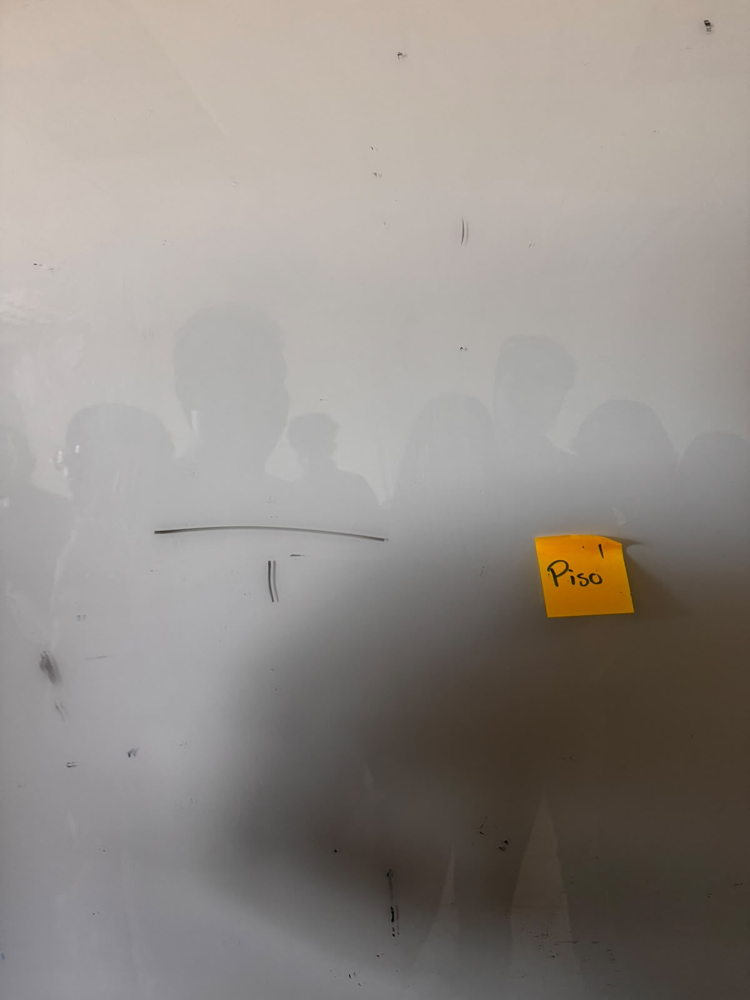
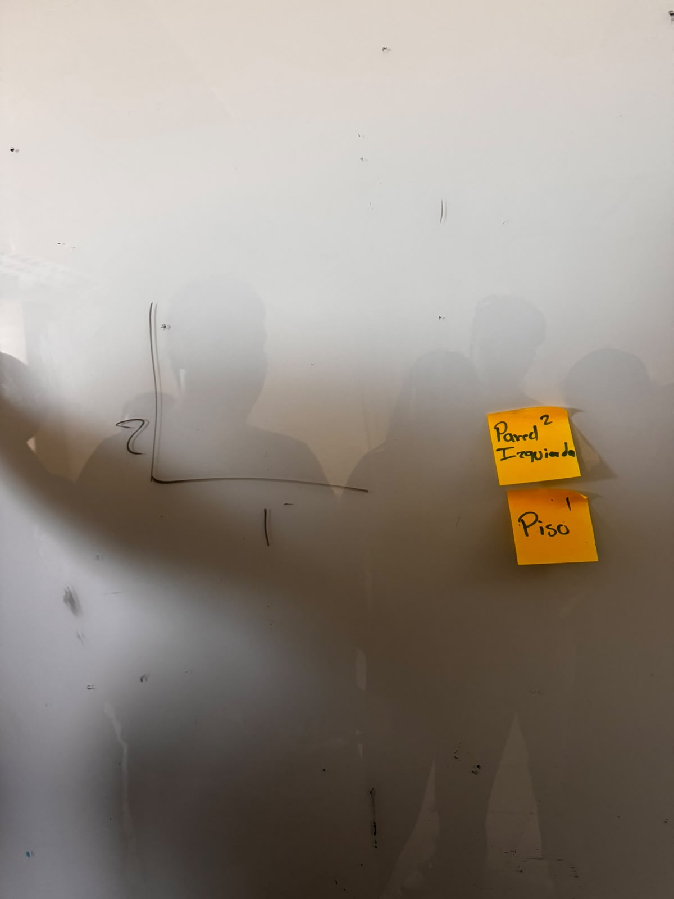
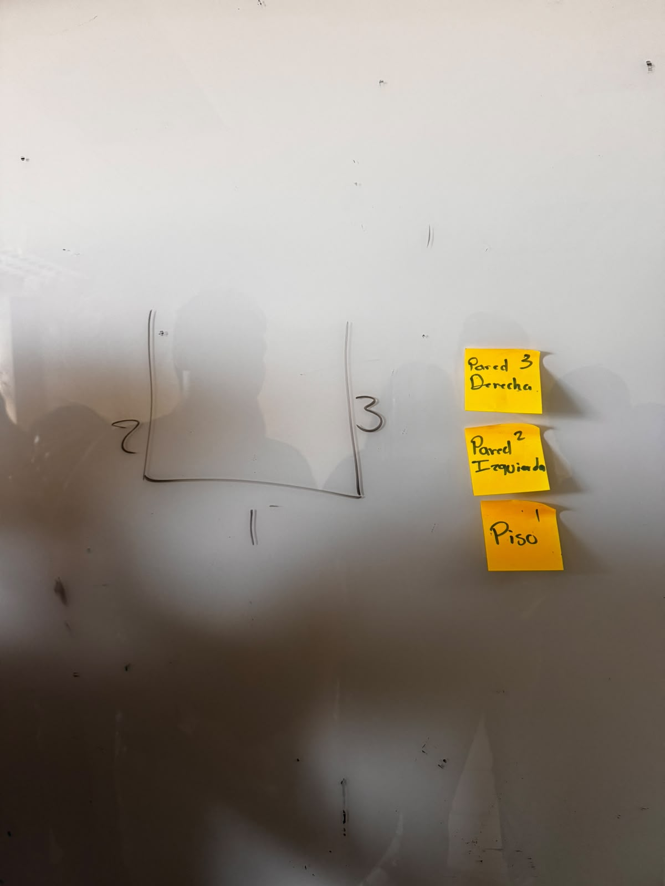
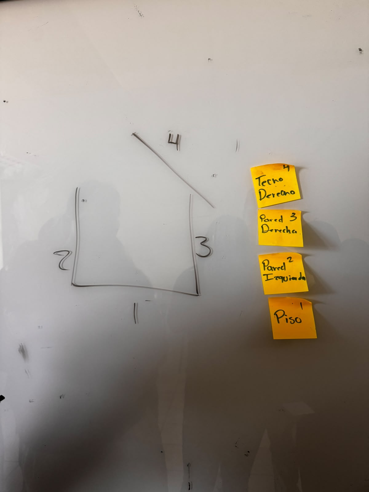
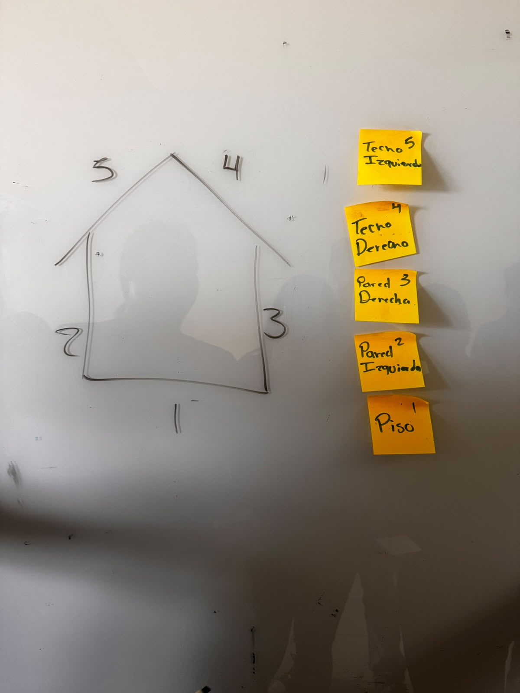
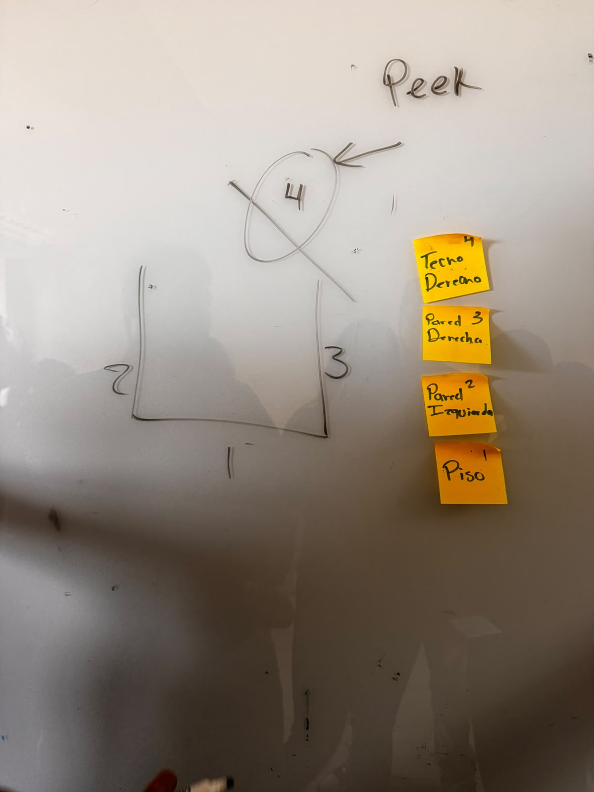
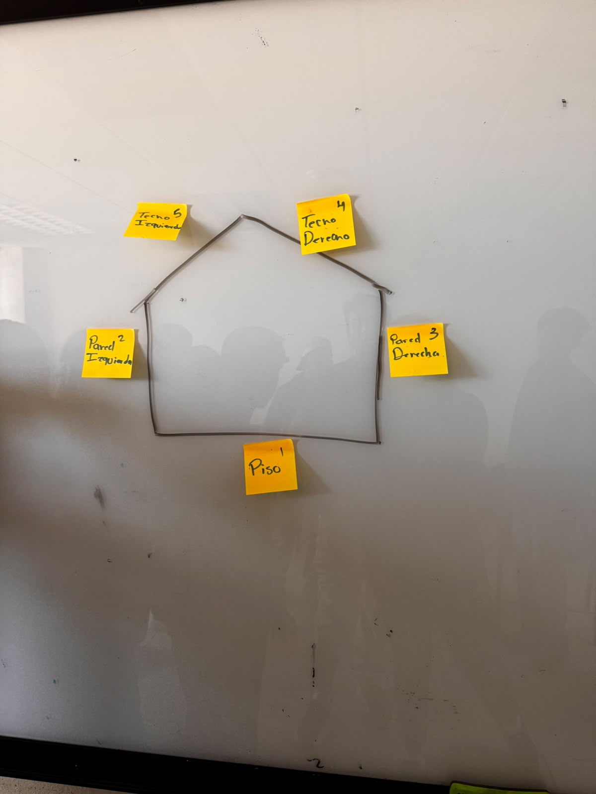

# Actividad lúdica: Pilas

## Integrantes

1. José Emmanuel Arredondo Escalante
2. Cristofer Gerardo Villanueva Ramirez
3. Maria Valeria Molina Rosas
4. Noemi Mata Ruiz
5. Ángel de Jesús Nolasco Rivera

## Objetivo

Comprender cómo funciona una pila mediante actividades prácticas, utilizando las operaciones `push`, `pop`, `peek` e `isEmpty`.

## Ronda 1: El estacionamiento

**Duración:** 10 minutos.

**Objetivo:** Comprender las operaciones `push` y `pop` y por qué solo se puede acceder directamente al elemento que está en el tope de la pila.

### Desarrollo

1. Los alumnos representan autos que entran uno por uno en un callejón. Cada auto que entra se agrega a la pila mediante `push`.
2. El docente solicita que salga un auto que está al fondo. Los autos que están delante deben salir primero mediante `pop` y colocarse temporalmente en una segunda pila.
3. El auto solicitado sale y los demás regresan en orden inverso al que salieron.
4. Un compañero cuenta los movimientos. Gana el equipo que complete la maniobra con menos movimientos y sin alterar el orden.

**Pregunta de cierre:** ¿Por qué no pudo salir directamente el auto que estaba al fondo?

### Evidencias fotográficas

#### Paso 1

#### Paso 2

#### Paso 3

## Ronda 2: Ctrl+Z humano

**Duración:** 8 minutos.

**Objetivo:** Comprender cómo se utilizan las pilas para deshacer acciones y practicar las operaciones `peek` e `isEmpty`.

### Desarrollo

1. Un alumno dibuja una casita en cinco trazos. Después de cada trazo, otro compañero agrega una tarjeta a la pila mediante `push`, describiendo la acción realizada.
2. Cuando el docente indica `Ctrl+Z`, se retira la tarjeta del tope mediante `pop` y se borra el último trazo realizado.
3. Se utiliza `peek` para identificar qué acción se desharía a continuación sin retirar la tarjeta.
4. Se utiliza `isEmpty` para comprobar si todavía quedan acciones por deshacer.

### Evidencias fotográficas

#### Paso 4

#### Paso 5

#### Operación peek

## Evidencia final

## Conceptos aprendidos

- **Push:** agrega un elemento al tope de la pila.
- **Pop:** elimina y devuelve el elemento que está en el tope.
- **Peek:** permite consultar el elemento del tope sin eliminarlo.
- **IsEmpty:** comprueba si la pila está vacía.
- **LIFO:** significa *Last In, First Out*; el último elemento en entrar es el primero en salir.

## Conclusión

Mediante las actividades del estacionamiento y Ctrl+Z, comprendimos que una pila funciona con el principio LIFO. Esto significa que el último elemento agregado es el primero que se retira. También aprendimos que solo se puede acceder directamente al elemento que está en el tope, por lo que es necesario retirar los elementos anteriores para llegar a uno que está al fondo.
Estas actividades permiten relacionar las operaciones de las pilas con situaciones de la vida cotidiana, como organizar objetos y deshacer acciones en un programa.
